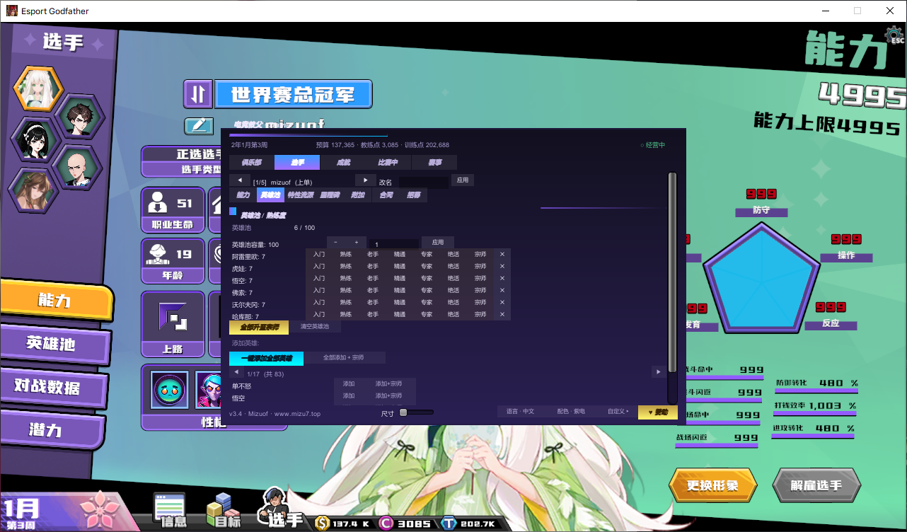
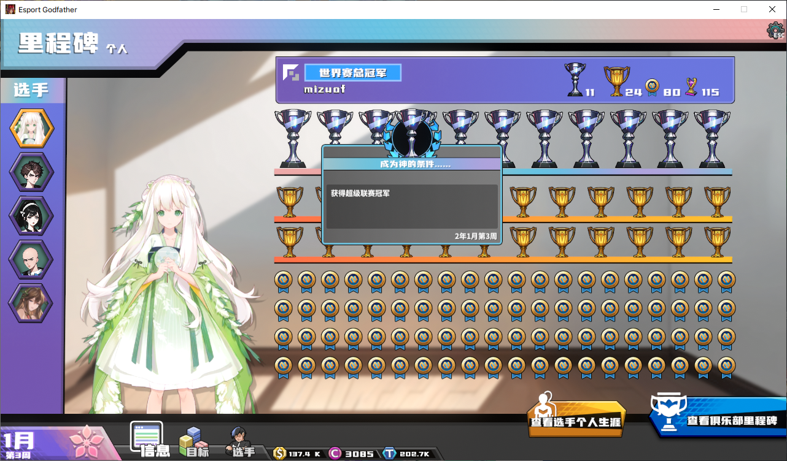

# 电竞教父 修改器 · EsportsTrainer

[简体中文](#简体中文) | [English](#english)

---

## 简体中文

电竞教父 MelonLoader Mod — 游戏内修改面板，按 **F1** 打开。




### 安装方法

**1. 安装 MelonLoader**

下载 [MelonLoader.Installer.exe](https://github.com/LavaGang/MelonLoader.Installer/releases/download/4.3.0/MelonLoader.Installer.exe)：

1. 在列表中找到 **Esport Godfather**（电竞教父）
2. **Install v0.7.2**（开发环境为 v0.7.3）
3. 选择 **MonoBleedingEdge**（游戏为 Mono，非 IL2CPP）
4. 安装后**运行一次游戏**，进入主界面再退出
5. 游戏根目录出现 `MelonLoader/` 与 `Mods/` 即成功

**2. 安装 Mod**：将 `EsportsTrainer.dll` 放入游戏根目录的 `Mods/` 文件夹。

**3. 启动**：进入主界面按 **F1** 打开面板。

> Steam 游戏目录：Steam 库 → 右键 Esport Godfather → 管理 → 浏览本地文件。

### 功能面板

| Tab | 功能 |
|-----|------|
| **俱乐部** | 资源（教练点/训练点/预算/世界分/粉丝，输入+应用，一键全满）· 勋章（搜索解锁/一键全解锁/分页浏览）· 里程碑（进度/全部解锁领奖/单条解锁）· 发展（晋级/降级、教练晋升、**教练直升 S**、**解锁全部升级项**、**俱乐部升级全部完成**、观众支持度拉满、场地升级、**贷款逐笔金额/利率修改 + 0 元还贷**、训练研究）· 荣誉（奖杯记录明细）· **训练必成**（日常训练必定大成功 / 能力训练必定大成功，Harmony） |
| **选手** | 能力（五维滑块+单维/全部全满、潜力 D~S+、**能力上限突破（AutoBreak / 超限 999）**、**英雄适应性**官方中文+当前状态+一键全职业 S）· 英雄池（容量输入增减、7 级熟练度、移除、**一键添加全部英雄**、清空）· 特性流派（流派上限、技能槽/卡槽装满、按类型分页添加）· 里程碑（个人里程碑进度/解锁领奖）· 附加（魅力、**粉丝自定义输入增减应用**、称号授予、**职位显示与同位互换**、**性格已添加可删/未添加可加**、**心情 7 级直设 + 全员亢奋**、装备列表增删、战斗数据 10 项精编*战斗中*）· 合同（**年龄/职业生命/分路修改**、**薪资档/签约费档/剩余赛季**、薪资/违约金/满意度实时显示、续约/重置）· 招募（5 分路+能力+年龄、一键满属性改造） |
| **成就** | 成就（官方中文名、实时进度、单条解锁、一键全部含 Steam 同步）· 队内关系（对立/普通/友好/亲密逐对设置、**一键亲密（主选×全员）**、**全员两两亲密**） |
| **比赛中** | 赛点/全局（回合数、倍速 x1/x3、暂停恢复、**魔龙/先锋触发倒计时**、双方战术点、**自动BP**、**禁止AI出牌（仅敌方）**、**我方AI自动指挥**、强制获胜/失败、立即终结）· **我方选手 / 敌方选手双区**：逐选手编辑等级经验/当前血量/最大血量/金钱/攻击力/护甲/暴击率/存在感、装备增删 · **战斗结束自动还原全部修改（自动BP 除外）** |
| **赛事** | 版本规则锁定、训练点倍率、赛事格式 BO1/BO3/BO5、全局速度、F2 数据快照 |

**底栏**：尺寸缩放 · **中/EN 语言切换（227+ 词条全覆盖）** · 配色预设（紫电/赤焰/苍翠）· 自定义主/辅/金色 hex · 赞助

**UI**：实心长方形按钮（任意宽度不变形），normal/hover/active 三态主题配色。

### 快捷键

| 按键 | 功能 |
|------|------|
| F1 | 打开/关闭修改面板 |
| F2 | 输出完整游戏数据快照到 MelonLoader 控制台 |

### 构建

```bash
dotnet build Trainer/EsportsTrainer.csproj
```

需要 .NET SDK（net48 目标）。项目引用（游戏目录内）：

| 依赖 | 路径 |
|------|------|
| MelonLoader.dll / 0Harmony.dll | `MelonLoader/net35/` |
| Assembly-CSharp.dll（游戏主程序集） | `Esport Godfather_Data/Managed/` |
| UnityEngine 系列 | `Managed/` |
| FairyGUI.dll（游戏 UI 框架） | `Managed/` |
| Utility / Utility.GameSystem | `Managed/` |

构建产物自动输出到 `Mods/`，无需手动拷贝。

### 更新日志

见 [CHANGELOG.md](CHANGELOG.md)（v3.5.0：比赛面板重构 / 训练必成 / 职位·合同·贷款编辑 / 中英语言包 / 战斗结束自动还原 等）。

---

## English

MelonLoader mod for *Esports Godfather* — in-game trainer panel, press **F1** to open.

### Installation

**1. MelonLoader**: run [MelonLoader.Installer.exe](https://github.com/LavaGang/MelonLoader.Installer/releases/download/4.3.0/MelonLoader.Installer.exe), pick **Esport Godfather**, install **v0.7.2** (dev env: v0.7.3), choose **MonoBleedingEdge**, then run the game once to the main menu.

**2. Mod**: drop `EsportsTrainer.dll` into the game's `Mods/` folder.

**3. Launch**: press **F1** in the main menu.

### Features

| Tab | Features |
|-----|----------|
| **Club** | Resources (coach/train points, budget, world pts, fans — editable) · Medals (search / unlock all / paged) · Milestones · Development (promote/demote, coach up / **coach to S**, unlock all upgrades, **complete all club upgrades**, max show support, venue upgrade, **per-loan amount & rate editing + 0-cost repay**, training research) · Honors · **Guaranteed Training** (daily always Great Success / ability training always better success, Harmony) |
| **Athletes** | Abilities (5 sliders, max all, potential D~S+, **break ability limit (AutoBreak / overlimit 999)**, **hero adaptability** with official CN names, live state and one-click S) · Hero pool (capacity editor, 7 mastery levels, **add all heroes**, clear) · Traits/styles (prime set limit, fill skills/cards, paged add by type) · Milestones · Extra (charm, **fans editor**, titles, **position display & swap with substitute**, **personalities added/removable & not-added/addable**, **7-level mood + max mood for all**, equipment add/remove, battle data precision editor in match) · Contract (**age / career life / role** editing, **salary & sign-cost level, seasons left**, live salary/penalty/satisfaction, renew/reset) · Recruit (5 roles, ability & age, max reroll) |
| **Achievements** | Official CN names, real-time progress, single/all unlock (incl. Steam sync) · Relations (per-pair set, **intimate all**, **all pairs intimate**) |
| **Match** | Round, speed, pause, **dragon/pioneer countdown**, tactic points both sides, **auto BP**, **forbid AI cards (enemy only)**, **ally AI auto-command**, force win/lose, instant finish · **Our/Enemy athletes dual zone**: per-athlete editing of level/exp, HP, max HP, gold, attack, armor, crit rate, presence, equipment add/remove · **Auto-restore all match edits on battle end (except auto BP)** |
| **Season** | Lock version rules, train-point multiplier, BO1/BO3/BO5 formats, global speed, F2 snapshot |

**Bottom bar**: UI scale · **CN/EN language toggle (227+ entries)** · theme presets (Violet / Blaze / Verdant) · custom hex colors · donate

**UI**: solid rectangular buttons (no distortion at any width), normal/hover/active themed states.

### Hotkeys

| Key | Action |
|-----|--------|
| F1 | Toggle trainer panel |
| F2 | Dump full data snapshot to console |

### Build

```bash
dotnet build Trainer/EsportsTrainer.csproj
```

.NET SDK (net48 target). References (from the game folder):

| Dependency | Path |
|------|------|
| MelonLoader.dll / 0Harmony.dll | `MelonLoader/net35/` |
| Assembly-CSharp.dll | `Esport Godfather_Data/Managed/` |
| UnityEngine modules | `Managed/` |
| FairyGUI.dll | `Managed/` |
| Utility / Utility.GameSystem | `Managed/` |

Build output goes straight to `Mods/` — no manual copy needed.

### Changelog

See [CHANGELOG.md](CHANGELOG.md) (v3.5.0: match panel rebuild / guaranteed training / position·contract·loan editors / CN-EN language pack / auto-restore on battle end, etc.)

---

**作者 / Author**: Mizuof
**B站**: https://space.bilibili.com/516995192/dynamic
**网站 / Site**: www.mizu7.top

*本修改器完全免费，请勿用于商业用途。 / Free of charge. Do not use commercially.*
